**1. Configuració inicial amb IP estàtica**  
A la captura es veu el fitxer `00-installer-config.yaml` mentre configura la interfície `enp0s3` amb una adreça IP estàtica: `192.168.1.100/24`, la porta d'enllaç `192.168.1.1` i el servidor DNS `192.168.1.1`. Després, el canvi es prepara i es crea el commit anomenat «feat: configura IP estatica per a enp0s3».

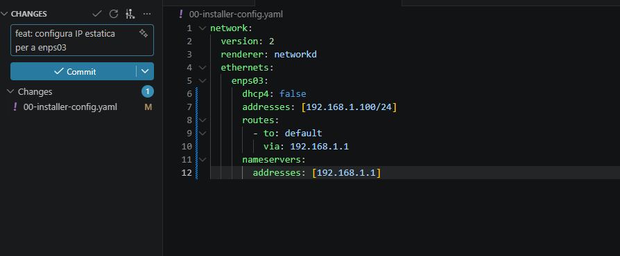

**2. Canvi de la configuració estàtica a DHCP**  
S'ha modificat el fitxer `00-installer-config.yaml` perquè la interfície `enp0s3` obtingui la configuració de xarxa automàticament mitjançant DHCP. La configuració estàtica, les adreces i la ruta predeterminada s'han eliminat i el resultat s'ha enregistrat en un nou commit.

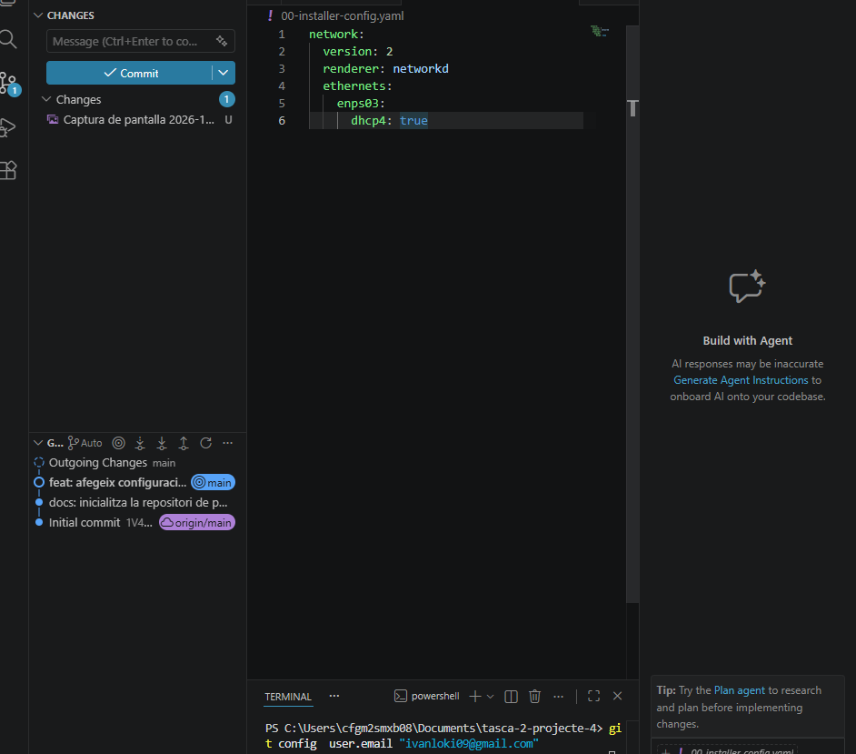

**3. Consulta completa de l'historial**  
Amb `git log` s'ha consultat l'historial complet del repositori. Es mostren els commits, els seus identificadors, els autors, les dates i els missatges. Aquest exemple permet veure l'ordre i els detalls de cada canvi realitzat.

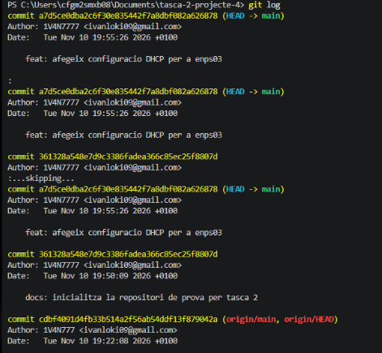

**4. Consulta resumida de l'historial**  
L'ordre `git log --oneline` mostra una versió curta i compacta de l'historial. Cada línia conté únicament una part de l'identificador SHA i el missatge del commit, cosa que facilita revisar ràpidament les modificacions.

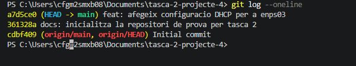

**5. Representació gràfica del repositori**  
La vista gràfica mostra les branques i els commits del projecte. També indica que existeixen canvis encara sense confirmar i que la branca `main` està alineada amb `origin/main`. Les branques remotes i l'historial s'observen en forma d'arbre.

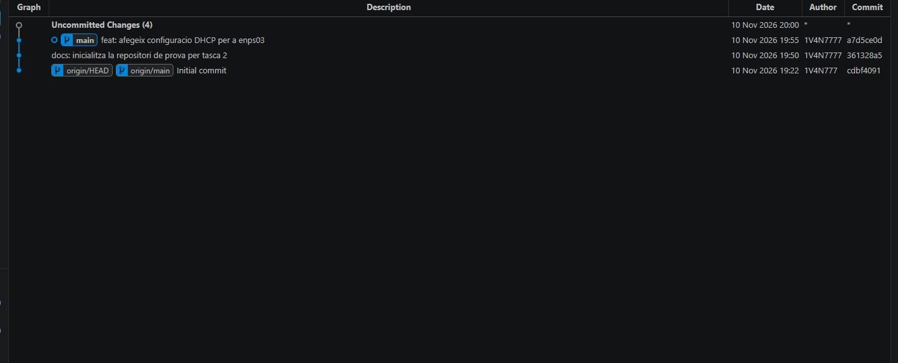

**6. Examen detallat del commit més recent**  
Amb `git show` i `git show --stat` s'ha revisat el commit més recent, incloent-hi autor, data i missatge. També es mostra el diff: el canvi principal ha estat substituir la configuració estàtica per DHCP a l'arxiu `00-installer-config.yaml`.

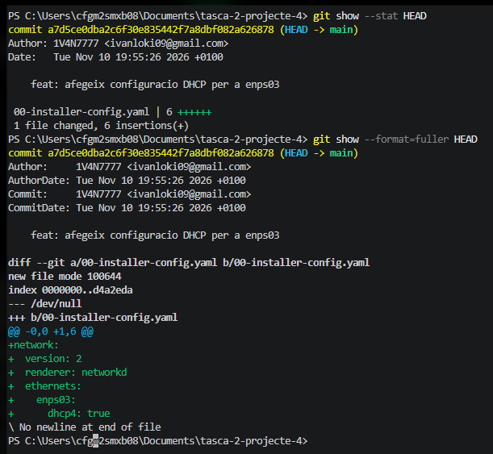

**7. Modificació no confirmada i estat del repositori**  
S'ha afegit una segona interfície temporal anomenada `eth0` al fitxer de configuració amb DHCP. Després, `git status` mostra que aquest fitxer és modificat i encara no s'ha inclòs en cap commit. També indica que la branca és local i que cal fer `push` per publicar els commits.

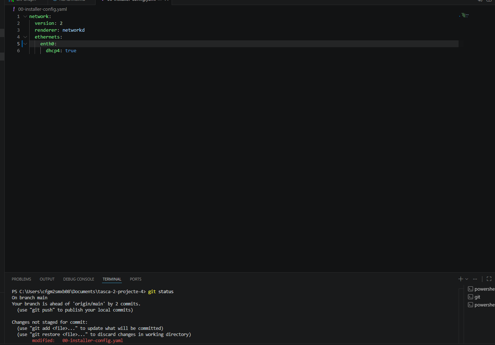

**8. Descart del canvi sense confirmar**  
S'ha executat `git restore 00-installer-config.yaml` per recuperar la versió enregistrada al repositori i eliminar la modificació no confirmada feta sobre el fitxer. Així s'ha eliminat la configuració temporal de la segona interfície.

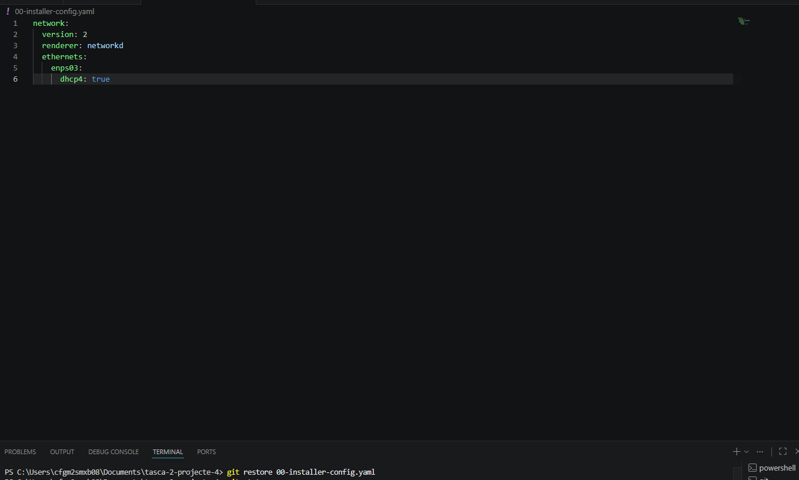

**9. Alta d'una segona interfície DHCP**  
S'ha tornat a editar el fitxer `00-installer-config.yaml` i s'ha afegit una segona interfície, `eth0`, amb DHCP activat. Els dos blocs, `enp0s3` i `eth0`, quedaven representats dins de la secció `ethernets`.

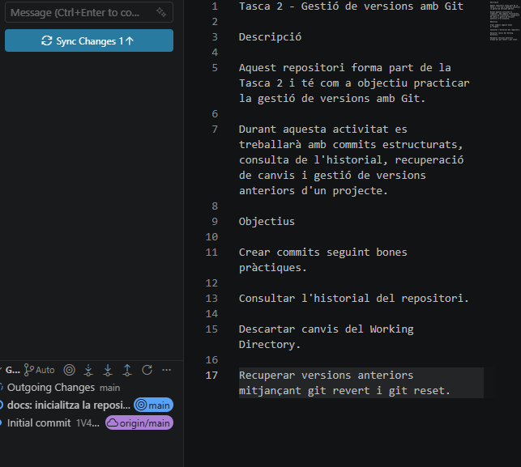

**10. Modificació del servidor DNS**  
S'ha canviat el servidor DNS de la interfície `enp0s3` i s'ha substituït `192.168.1.1` per `8.8.8.8`. El programa Git informa que el fitxer ha canviat i el nou estat es prepara per ser inclòs en un commit.

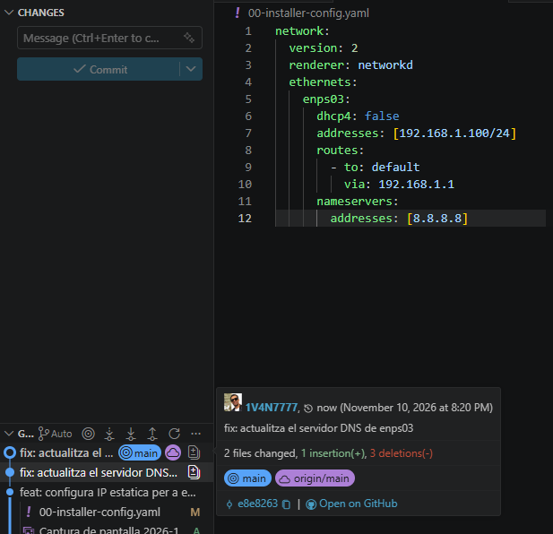

**11. Revert d'un canvi anterior**  
S'ha utilitzat `git revert` per crear un nou commit que desfà els canvis d'un commit anterior. En aquest cas, el missatge indica «Revert fix: actualitza el servidor DNS de enp0s3». Això permet anul·lar modificacions conservant l'historial i sense esborrar commits previs.

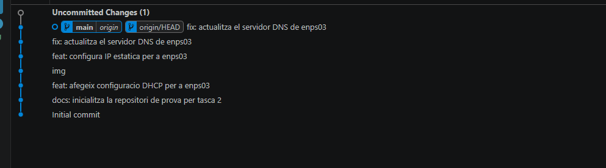

**12. Consulta i exploració dels commits**  
Aquesta captura mostra l'historial després d'aplicar revert i els altres commits realitzats. Es poden veure els missatges, les referències i els identificadors dels commits, inclosos els canvis de configuració, els revert i els commits anteriors del repositori.

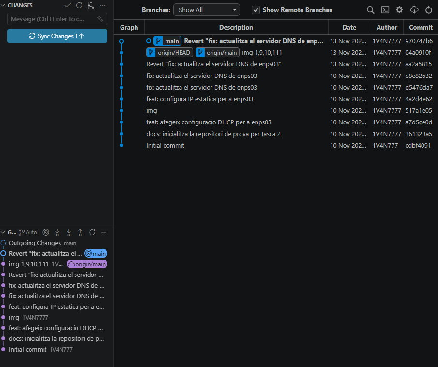

**13. Prova de reset a un commit anterior**  
S'ha executat `git reset --hard HEAD~4` per intentar moure la branca quatre commits enrere i restablir també l'arxiu de treball. Git indica que `HEAD` ha arribat al commit `ca64f09`. Aquesta ordre pot eliminar commits i canvis locals en cas d'usar-la amb `--hard`.

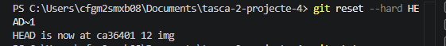

**14. Estat final i neteja del repositori**  
La captura final de `git status` indica que no hi ha canvis pendents i que el directori de treball està net. La branca `main` apareix actualitzada i l'historial conserva els commits finals després de les operacions de revert i reset.

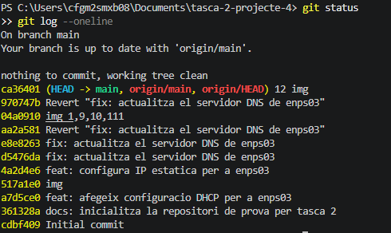