### 1. Crear el disc dur virtual

En VirtualBox, s'ha seleccionat la ubicació i el nom del disc virtual. El fitxer tindrà format VDI i una mida inicial de 10 GB.

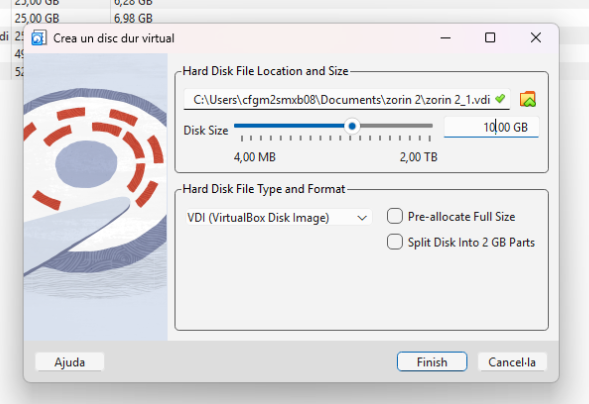

### 2. Comprovar els discs del sistema

Amb `lsblk` es llisten els dispositius d'emmagatzematge detectats. Els discs són `/dev/sda`, `/dev/sdb` i el disc òptic `/dev/sr0`.

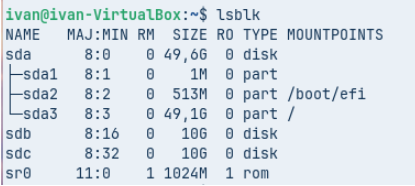

### 3. Consultar la versió de LVM

S'ha executat `sudo lvm version` per comprovar que VirtualBox disposa de les eines LVM i conèixer les seves versions.

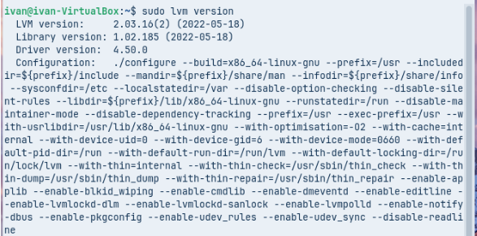

### 4. Crear els volums físics

Amb `sudo pvcreate /dev/sdb /dev/sdc` s'han inicialitzat els dos discs com a volums físics perquè LVM els pugui utilitzar.

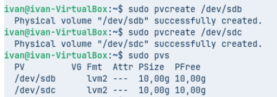

### 5. Crear el grup de volums

Amb `sudo vgcreate vg_lvm /dev/sdb /dev/sdc` s'han agrupat els volums físics en un grup anomenat `vg_lvm`, amb uns 19,99 GB disponibles.

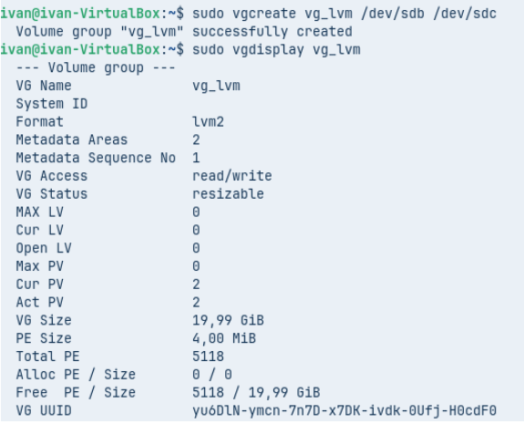

### 6. Crear el volum lògic inicial

Amb `lvcreate -L 5G -n lv_inicial vg_lvm` s'ha creat dins del grup el volum lògic `lv_inicial` amb una mida de 5 GB.

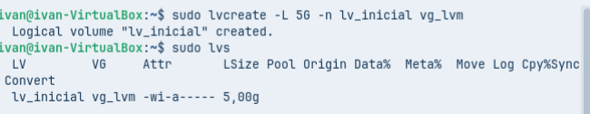

### 7. Donar format al volum lògic

S'ha formatat `/dev/vg_lvm/lv_inicial` amb el sistema de fitxers ext4 mitjançant `mkfs.ext4`.

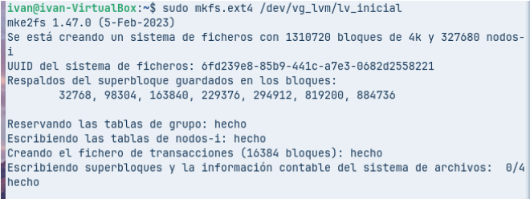

### 8. Crear i muntar el punt de muntatge

S'ha creat la carpeta `/mnt/lvm_inicial` i s'ha muntat el volum lògic en aquesta ruta amb `mount`.

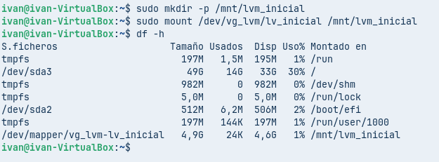

### 9. Configurar el muntatge automàtic

S'ha recarregat systemd i s'ha actualitzat `/etc/fstab` amb una entrada perquè el volum es munti automàticament.

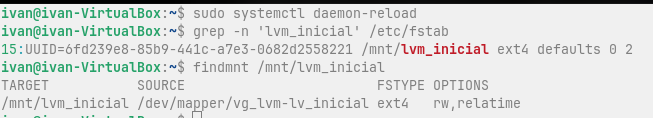

### 10. Comprovar la configuració d'arrencada

L'entrada següent també confirma que `/mnt/lvm_inicial` està associat al volum lògic i que utilitza el sistema ext4.

### 11. Crear el volum lògic RAID1

Amb `lvcreate --type raid1 -m 1 -L 26 -n lvm_mirror vg_lvm` s'ha creat `lvm_mirror` amb configuració RAID1 i una mida d'aproximadament 28 MB.

### 12. Comprovar el volum RAID1

`lv_name`, `lv_size` i `segtype` confirmen que `lvm_mirror` és un volum lineal de 28 MB replicat mitjançant dos dispositius RAID1.

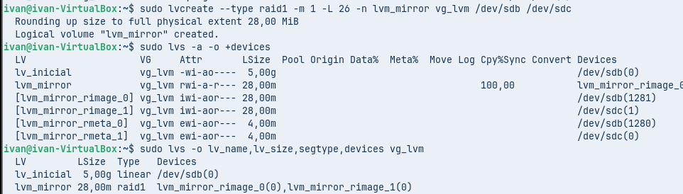

### 13. Crear els fitxers de prova

Dins del punt de muntatge s'han creat els fitxers `archivo1`, `archivo1.txt`, `archivo2.txt` i `archivo3.txt`.

### 14. Ampliar el volum lògic

Amb `lvextend -L +10G` s'ha ampliat el volum `lv_dades` i el sistema de fitxers ha passat de tenir 19,99 GB disponibles a una nova mida total.

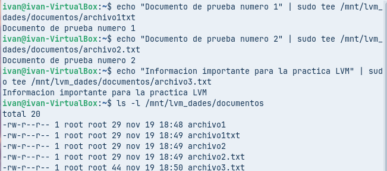

### 15. Crear i mostrar els volums

`pvs` i `lvs -a -o +devices` permeten veure que hi ha espai disponible i que els volums utilitzen `/dev/sdb` i `/dev/sdc`.

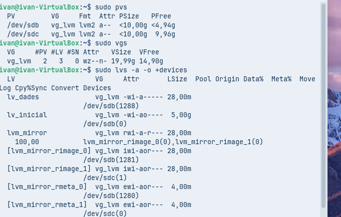

### 16. Comprovar el sistema de fitxers i crear l'instantània

Primer s'ha comprovat el sistema amb `blkid` i `findmnt`. Després s'ha creat `lv_snapshot` amb una mida de 1 GB.

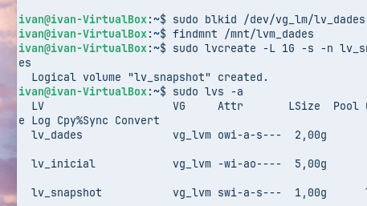

### 17. Repetir la verificació de l'instantània

Es torna a mostrar el volum `lv_snapshot`: és un volum tipus snapshot amb una mida d'1 GB.

### 18. Afegir més fitxers de prova

S'han llistat els documents existents i després s'ha creat `archivo_nuevo.txt`, que apareix al directori amb els altres fitxers.

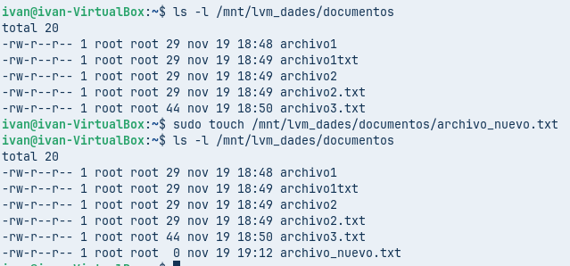

### 19. Confirmar els canvis als fitxers

La nova captura torna a mostrar el directori amb els quatre fitxers originals i el fitxer `archivo_nuevo.txt` acabat de crear.

### 20. Redimensionar el sistema de fitxers

Amb `resize2fs /dev/vg_lvm/lv_dades` s'ha ampliat el sistema de fitxers ext4 perquè coincideixi amb la mida ampliada del volum.

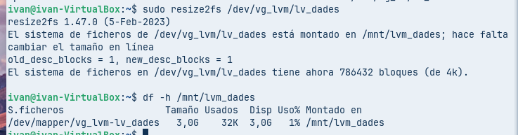

### 21. Verificar el volum després del redimensionament

La comanda `lvs -a` mostra la distribució final: `lv_dades` ha quedat amb 3 GB, `lv_inicial` amb 5 GB i `lv_snapshot` amb 1 GB.

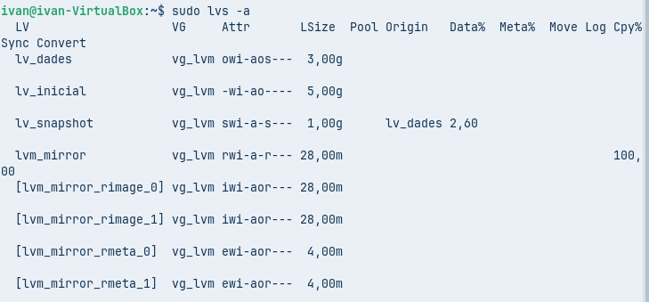