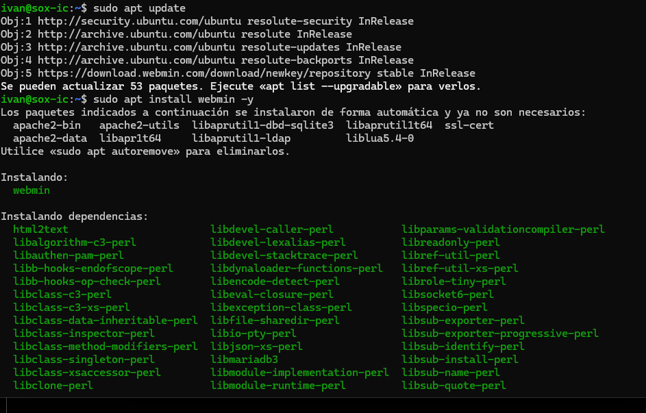
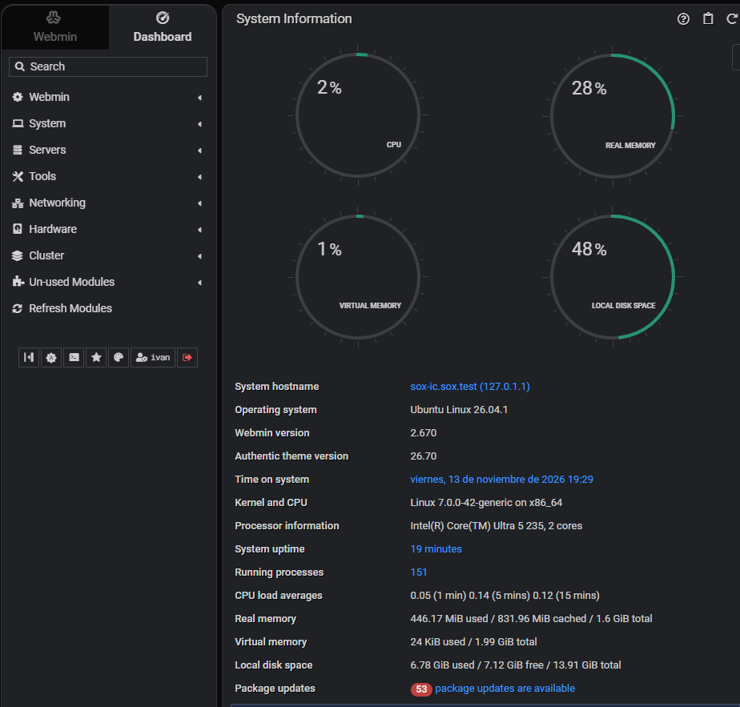
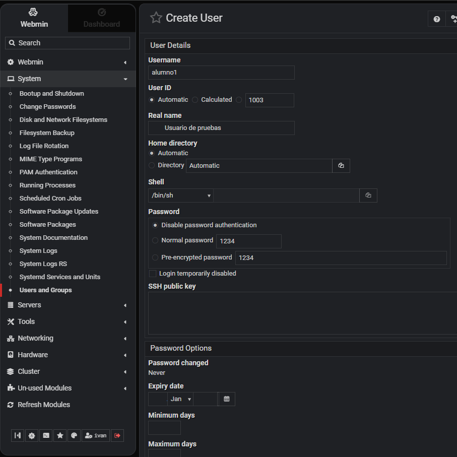
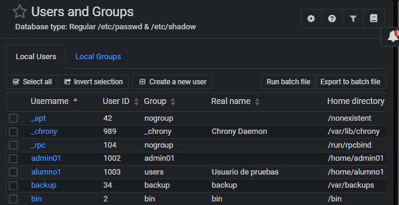
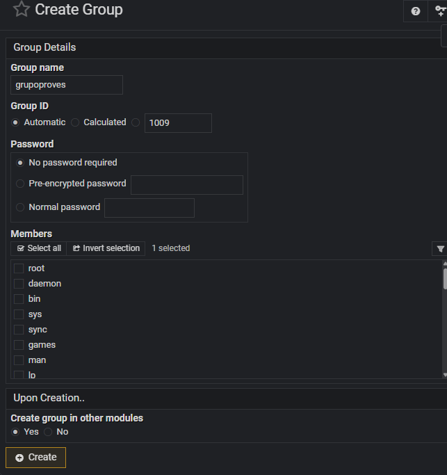
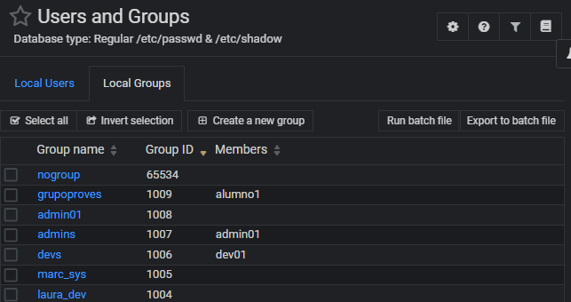
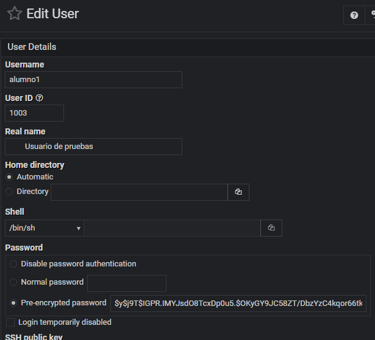
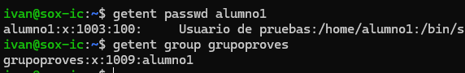

# Guia de Webmin

## Què és Webmin i com funciona?

**Webmin** és un gestor gràfic d'administració de servidors Linux que permet configurar el sistema des d'un navegador web. En lloc d'escriure totes les ordres en una terminal, utilitzem un menú visual amb diferents mòduls. Cada mòdul tradueix les opcions seleccionades en la configuració real de l'Ubuntu Server.

Per accedir-hi, cal obrir `https://<adreça-IP-del-servidor>:10000` i iniciar sessió amb un usuari amb permisos d'administració. Els canvis s'apliquen directament sobre el sistema operatiu i es poden comprovar després des de Webmin o des de la terminal.

## Com funciona aquesta pràctica

La pràctica comença amb la instal·lació de Webmin i l'accés al seu panell principal. Després naveguem pels mòduls **Sistema → Usuaris i Grups** per crear i modificar comptes i permisos. Finalment, utilitzem ordres de terminal per verificar que els canvis realitzats des de la interfície també s'han aplicat al sistema Linux.

A continuació es mostren les captures i els passos seguits:

## 1. Instal·lació de Webmin

A la primera captura s'afegeix el repositori oficial i s'instal·la Webmin amb l'apt. El procés descarrega el paquet i les dependències necessàries i finalitza amb el servei preparat per iniciar-se.

## 2. Panell principal i informació del sistema

Després de l'inici de sessió apareix el panell principal. Webmin mostra l'estat de la CPU, la memòria, la memòria virtual i el disc, juntament amb dades del sistema, com ara el nom d'amfitrió, la versió d'Ubuntu i de Webmin, el temps de funcionament i els processos actius.

## 3. Formulari de creació d'un usuari

A **Sistema → Usuaris i Grups → Crear un usuari nou** s'obre el formulari per donar d'alta un compte. Aquí es poden definir el nom d'usuari, l'identificador, el nom real, el directori personal, l'intèrpret d'ordres i la contrasenya.

En aquest cas es crea l'usuari `alumno1` amb UID assignat automàticament i la contrasenya indicada al formulari.

## 4. Comprovació de la creació de l'usuari

El nou usuari apareix a la llista de **Usuaris i Grups** amb el nom `alumno1`, l'UID `1003`, el grup primari `users` i el directori personal `/home/alumno1`. Això confirma que el compte s'ha creat correctament al sistema.

## 5. Formulari de creació d'un grup

A continuació s'accedeix a la secció de grups i se selecciona **Crear un grup nou**. Al formulari s'introdueix el nom `grupoaproves`, mentre que el GID es pot assignar automàticament o calcular pel sistema.

També es pot afegir una llista de membres des d'aquesta mateixa pantalla.

## 6. Comprovació de la creació del grup

La llista de grups mostra `grupoaproves` amb GID `1009`. El grup conté l'usuari `alumno1`, tal com indiquen les dades de membres. Això indica que el grup s'ha creat i que l'usuari hi ha estat afegit correctament.

## 7. Modificació de la contrasenya

Amb la opció d'editar l'usuari `alumno1` es pot canviar la seva contrasenya. Webmin permet desactivar-la, introduir una contrasenya normal o definir una contrasenya prexifrada, i també permet configurar altres opcions de compte.

En aquesta prova se selecciona una contrasenya prexifrada i se guarda la modificació de l'usuari.

## 8. Comprovació a la terminal

Per verificar les operacions fora de Webmin s'utilitzen les ordres `getent passwd alumno1` i `getent group grupoaproves`. El sistema mostra l'usuari amb UID `1003`, el directori `/home/alumno1` i el grup amb GID `1009`, confirmant que els canvis creats des de la interfície gràfica també existeixen al sistema Linux.

## Conclusió

La pràctica ha anat bé perquè ha estat possible instal·lar Webmin, accedir al seu panell principal i utilitzar les seves eines gràfiques per administrar el servidor Ubuntu. Les proves de creació d'usuari i de grup s'han completat correctament, i la modificació de la contrasenya s'ha realitzat des de la mateixa interfície.

També ha estat positiu verificar els resultats des de la terminal amb les ordres `getent passwd` i `getent group`. D'aquesta manera hem pogut confirmar que els canvis fets amb Webmin no només apareixen a la interfície, sinó que també s'apliquen realment al sistema Linux.

En conclusió, Webmin facilita l'administració perquè permet executar tasques habituals sense haver de recordar totes les ordres de terminal. Això el converteix en una eina útil per a administradors i usuaris que necessiten gestionar un servidor Linux mitjançant una interfície accessible des del navegador.